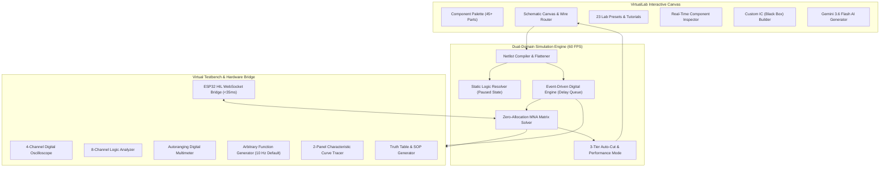

# VirtualLab-HIL — Documentation & System Guide

> **Next-Generation Mixed-Signal Electronic Circuit Simulator & Hardware-in-the-Loop (HIL) Platform**

---

## Welcome to VirtualLab-HIL

**VirtualLab-HIL** is a comprehensive, browser-native electronic laboratory engineered for electrical engineering education, rapid prototyping, and research. It bridges the gap between purely theoretical software circuit simulation and physical hardware experimentation by combining:

1. A **Zero-Allocation Modified Nodal Analysis (MNA)** analog solver running at a steady 60 FPS.
2. A **Multi-Pass Digital Logic Solver** with propagation delay modeling and interactive pin defaults.
3. An **ESP32 Hardware-in-the-Loop (HIL)** bridge communicating over high-speed WebSockets (<35ms latency).
4. An **AI Circuit Synthesis Engine** driven by Google Gemini 3.6 Flash.
5. An interactive **Laboratory Presets Suite** featuring 23 pre-wired, mathematically verified experiments.

---

## Documentation Quick Links

| Guide | Description | Target Audience |
| :--- | :--- | :--- |
| [📖 **Complete User Manual**](USER_MANUAL.md) | Complete guide covering workspace navigation, wire routing, instrument manuals, and walkthroughs for all 23 laboratory experiments. | Students, Educators, Engineers |
| [⚡ **Component Encyclopedia**](FEATURES_REFERENCE.md) | Technical reference of all 45+ components with terminal definitions, MNA companion models, non-linear equations, and parameter ranges. | Circuit Designers, Developers |
| [🔌 **ESP32 Hardware Guide**](HIL_HARDWARE_GUIDE.md) | Pinout tables, breadboard wiring schematics, captive-portal Wi-Fi setup, and dual-core FreeRTOS C++ firmware. | Embedded Systems & IoT Engineers |
| [🖥️ **Deliverable Device & TFT Mini OS**](DELIVERABLE_DEVICE_TFT_GUIDE.md) | Transform the ESP32 into a standalone physical instrument with a 2.8" color TFT LCD running DisplayOS. | Makers, Hardware Packaging, Labs |
| [🤖 **AI Circuit Synthesis Guide**](AI_CIRCUIT_SYNTHESIS_GUIDE.md) | Natural language prompting guidelines, JSON netlist schema, key pool rotation, and auto-routing compiler documentation. | AI Integrators & Power Users |

---

## System Architecture

---

## Core Capabilities at a Glance

### 1. High-Performance Hybrid Simulation Engine
- **Zero-Allocation MNA Pool**: Pre-allocated flat buffers for Gaussian elimination eliminate browser garbage collection pauses.
- **Synchronized Mixed-Signal Coupling**: Digital gates stamp low-impedance totem-pole CMOS drivers into the analog matrix, while analog voltages feed back into digital logic nets.
- **10 Hz Distortion-Free Defaults**: All AC voltage sources and function generators default to 10.0 Hz, ensuring smooth, non-aliasing waveforms on standard 60 FPS display displays.
- **3-Tier Protection**: Automatically drops to Performance Mode or safely pauses if thread lag or non-convergent mathematical singularities occur.

### 2. 45+ Component Library & Pin Defaults
- **Passives & Sources**: Resistors, Capacitors, Inductors, Standard Transformers, Center-Tapped Transformers, Potentiometers, AC/DC Voltage Sources, Current Sources.
- **Semiconductors**: Diodes, Zener Diodes, LEDs with color-dependent forward voltages ($V_f$), NPN/PNP BJTs with Early voltage ($V_A$), N-channel and P-channel MOSFETs with channel-length modulation ($\lambda$).
- **Integrated Circuits & Op-Amps**: 555 Timers (Astable/Monostable), Rail-to-Rail Op-Amps with internal $\pm 15\text{V}$ virtual rails or external rail enforcement.
- **Digital MSI Logic**: Gates (AND, OR, NOT, NAND, NOR, XOR, XNOR), Flip-Flops (D, T, JK, SR), Latches, 4-Bit Binary Counters, Multiplexers (2:1, 4:1, 8:1), Demultiplexers (1:2, 1:4), Priority Encoders (4:2, 8:3), and Decoders (2:4, 3:8, BCD-to-7-segment).
- **Interactive Pin Push-Buttons**: Unconnected digital input pins feature interactive `[0]` / `[1]` canvas push-buttons that automatically hide when a wire is connected.

### 3. Comprehensive Virtual Instrumentation
- **4-Channel Digital Oscilloscope**: Real-time multi-trace view with Time/Div timebases, Volts/Div attenuators, AC/DC coupling, hardware edge triggering, and automated telemetry ($V_{pp}, V_{max}, V_{min}, V_{rms}, \text{Freq}$).
- **8-Channel Logic Analyzer**: Logic timing diagrams with trigger patterns, configurable timebase, and CSV trace export.
- **Dual-Panel Characteristic Curve Tracer**: Automated voltage/current sweeps plotting $I_c$ vs $V_{ce}$, Diode I-V curves, and FET transfer characteristics.
- **Truth Table Generator**: Automatically exercises combinational and sequential sub-circuits across all $2^N$ input combinations, generating boolean SOP equations.

### 4. Custom Component (Black Box IC) Builder
- Package any schematic sub-circuit into a reusable multi-pin IC chip saved in browser storage.
- Custom pin mapping (Left, Right, Top, Bottom) with live chip package preview, package notch, custom accent colors, and JSON import/export.

### 5. Hardware-in-the-Loop (ESP32) Bridge
- Bi-directional synchronization between physical ESP32 GPIOs and canvas schematic nodes over WebSockets.
- Includes captive portal Wi-Fi provisioning and complete FreeRTOS dual-core firmware.

---

## Getting Started in 60 Seconds

1. **Add Components**: Drag components from the left **Component Palette** onto the canvas, or click any part to spawn it.
2. **Wire Terminals**: Click and drag from any terminal handle to connect pins. Active wires turn orange with animated current flow dots during simulation.
3. **Control Simulation**: Press the **Run / Pause** button or hit the **Spacebar** to toggle live simulation.
4. **Inspect & Tune**: Click the gear icon on any component to adjust parameters in the **Component Inspector**, or double-click to edit inline.
5. **Explore Presets**: Click **`🧪 Lab Presets & Tutorials`** in the palette header to immediately launch any of the 23 pre-wired experiments.

---

*VirtualLab-HIL is an open-source educational electronic design and simulation project.*
