# 📖 VirtualLab-HIL — Complete User Manual & Laboratory Guide
**Version 1.4.0 (Mixed-Signal & Hardware-in-the-Loop)**  
*Next-Generation Interactive Circuit Simulator & Physical Microcontroller Bridge*

---

## Table of Contents
1. [Welcome & Core Capabilities](#1-welcome--core-capabilities)
2. [Quick Start & Workspace Overview](#2-quick-start--workspace-overview)
3. [Schematic Capture & Smart Wiring](#3-schematic-capture--smart-wiring)
4. [Dual-Domain Simulation Engine & Performance Controls](#4-dual-domain-simulation-engine--performance-controls)
5. [Virtual Instrumentation Suite](#5-virtual-instrumentation-suite)
   - [5.1 Dual-Channel Digital Oscilloscope](#51-dual-channel-digital-oscilloscope)
   - [5.2 Multi-Channel Digital Logic Analyzer](#52-multi-channel-digital-logic-analyzer)
   - [5.3 Characteristic Curve Analyzer (X-Y Parameter Sweeper)](#53-characteristic-curve-analyzer-x-y-parameter-sweeper)
   - [5.4 Combinational Truth Table Analyzer](#54-combinational-truth-table-analyzer)
   - [5.5 Arbitrary Function Generator](#55-arbitrary-function-generator)
   - [5.6 Multimeters, Voltmeters, Ammeters & Audio Speaker](#56-multimeters-voltmeters-ammeters--audio-speaker)
6. [Interactive Laboratory Presets & Step-by-Step Tutorials (23 Labs)](#6-interactive-laboratory-presets--step-by-step-tutorials)
   - [6.1 RC Filters & Pulse Shapers (Labs 1–3)](#61-rc-filters--pulse-shapers)
   - [6.2 Diodes, Limiters & Power Supplies (Labs 4–8)](#62-diodes-limiters--power-supplies)
   - [6.3 BJT Transistor Amplifiers & Biasing (Labs 9–12)](#63-bjt-transistor-amplifiers--biasing)
   - [6.4 MOSFETs & CMOS Digital Logic (Labs 13–14)](#64-mosfets--cmos-digital-logic)
   - [6.5 Operational Amplifiers & Active Filters (Labs 15–18)](#65-operational-amplifiers--active-filters)
   - [6.6 Digital Combinational MSI Circuits (Labs 19–21)](#66-digital-combinational-msi-circuits)
   - [6.7 Digital Sequential Counters & Dividers (Labs 22–23)](#67-digital-sequential-counters--dividers)
7. [Custom Component (Black Box IC) Builder](#7-custom-component-black-box-ic-builder)
8. [Gemini AI Natural Language Circuit Assistant](#8-gemini-ai-natural-language-circuit-assistant)
9. [Hardware-in-the-Loop (ESP32) Bridge](#9-hardware-in-the-loop-esp32-bridge)
10. [Electrical Rules Checking (ERC) & Diagnostic Engine](#10-electrical-rules-checking-erc--diagnostic-engine)
11. [Desktop Keyboard Shortcuts & Canvas Gestures](#11-desktop-keyboard-shortcuts--canvas-gestures)
12. [Troubleshooting & Frequently Asked Questions](#12-troubleshooting--frequently-asked-questions)

---

## 1. Welcome & Core Capabilities

**VirtualLab-HIL** is an interactive, browser-based electronic design automation (EDA) and mixed-signal simulation platform. It blends textbook-accurate semiconductor device physics with modern web performance and physical microcontrollers.

### Key Architectural Highlights
- **Dual-Domain Hybrid Solver**: Concurrently solves physical analog circuits using **Modified Nodal Analysis (MNA)** with Newton-Raphson non-linear iterations, and event-driven multi-pass **digital logic networks** (0, 1, X, Z).
- **Physical Device Physics**: Shockley diode equations, Zener reverse breakdown, BJT transistors with Early effect ($V_A$), square-law MOSFETs with channel-length modulation ($\lambda$), high-gain Op-Amps with internal/external rail clamping, and dynamic companion models for capacitors and inductors.
- **Hardware-in-the-Loop (HIL)**: Connect real ESP32 microcontrollers over TLS WebSockets ($<35\text{ ms}$ round-trip latency) to stream live ADC voltage inputs into virtual schematics and drive virtual simulation outputs to real ESP32 DAC and PWM pins.
- **Gemini AI Natural Language Synthesis**: Describe any analog or digital circuit in English; Gemini AI automatically lays out components, connects pins, and auto-routes wires.
- **Custom Black Box IC Builder**: Package any circuit schematic into a reusable multi-pin IC chip saved directly in browser storage.

---

## 2. Quick Start & Workspace Overview

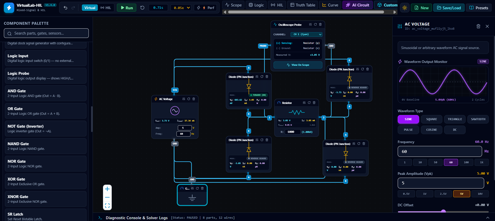
*Figure 2.1: VirtualLab-HIL main interface with Canvas, Left Component Palette, Top Navigation Bar, and Right Component Inspector.*

The interface consists of four primary functional zones:

1. **Top Navigation Bar**:
   - **Simulation Controls**: Mode selector (`Virtual` vs `HIL`), Run/Pause button, Clock time readout, Speed Multiplier (`0.05x` to `2.0x`), and Performance Mode (`⚡ Perf`).
   - **Virtual Instruments**: Direct launcher buttons for `Scope`, `Logic`, `HIL`, `Truth Table`, `Curve`, `AI Circuit`, and `Custom IC`.
   - **Utility Actions**: Theme toggle (Dark / Light), `New Project`, `Save/Load`, and the **`Manual`** button.
2. **Left Component Palette**:
   - Prominent **`🧪 Lab Presets & Tutorials`** launcher button.
   - Search bar filtering over 45+ components.
   - Categorized component library: Passives, Sources, Semiconductors, Digital Logic, Instruments, Controls, and HIL.
3. **Center Interactive Canvas**:
   - React Flow infinite workspace with pan, zoom, grid snapping, orthogonal wire routing, animated current flow, and magnetic pin snapping.
4. **Right Component Inspector**:
   - Dynamic parameter panel that updates whenever a component is selected, exposing physical electrical parameters in real time.

---

## 3. Schematic Capture & Smart Wiring

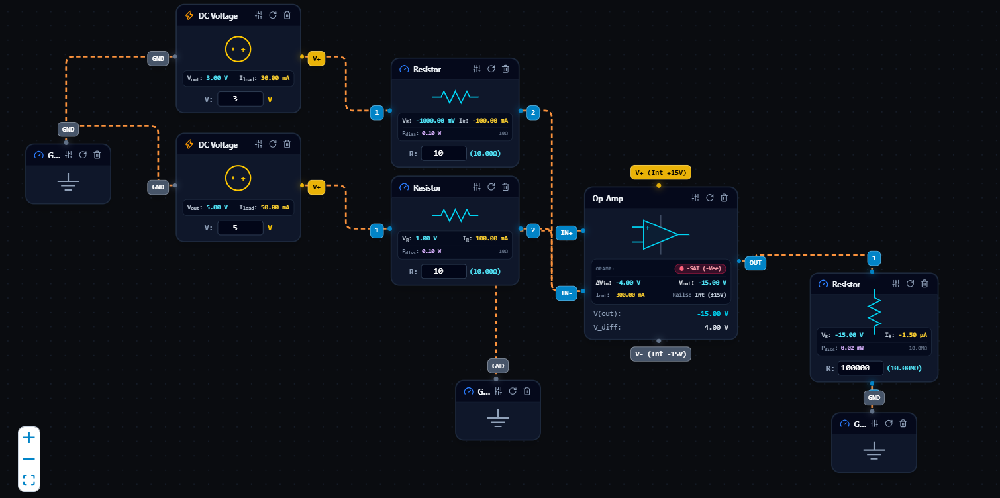
*Figure 3.1: Live schematic execution with vibrant orange current flow lines and dynamic node badges.*

### 3.1 Placing and Moving Components
- **Drag-and-Drop**: Drag any component from the Left Palette and release it onto the canvas.
- **Selection**: Click a component node to select it (opens its parameters in the Inspector).
- **Rotation**: Select a component and press <kbd>R</kbd> or click the rotate icon in the component card header to rotate by 90° clockwise.
- **Deletion**: Select a component or wire and press <kbd>Delete</kbd> or <kbd>Backspace</kbd>.

### 3.2 Wire Routing & Color Conventions
- **Wiring**: Click and drag from any terminal handle to another component's terminal. When close, magnetic snapping secures the connection.
- **Wire Color States**:
  - **Vibrant Orange (Running)**: Conventional current is flowing through the branch. Dashed particles animate in the physical direction of positive current ($I > 0$).
  - **Calm Blue (Stopped / Paused)**: The simulation clock is halted. Wires appear solid blue for clear schematic editing.
  - **Electric Yellow (Selected)**: The wire is selected. Press <kbd>Delete</kbd> to delete the connection.

### 3.3 Digital Pin Default Push-Buttons (`[0]` / `[1]`)
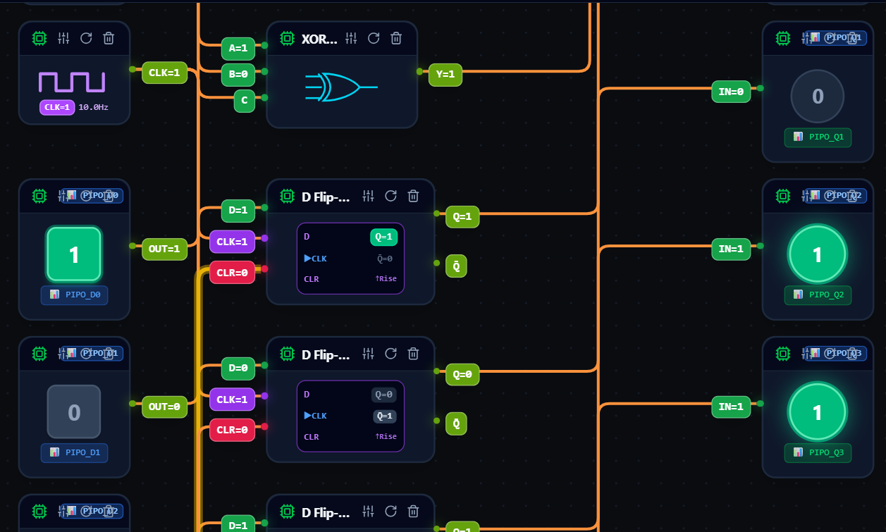
*Figure 3.2: Digital devices displaying compact interactive default badges on unconnected pins.*

To streamline digital prototyping without requiring external switches for every terminal:
- Every unconnected digital input pin automatically displays an interactive push-button badge (`[0]` or `[1]`).
- Enable pins (`EN`, `enable`) default to active-high `1`.
- Clicking the badge toggles the logic level immediately in both the UI and solver.
- Connecting a wire automatically hides the button, delegating control to the driving net.

---

## 4. Dual-Domain Simulation Engine & Performance Controls

VirtualLab-HIL runs a zero-allocation Modified Nodal Analysis (MNA) solver synchronized with a multi-pass digital logic engine at 60 FPS.

### 4.1 Frequency Conventions
All AC voltage sources, function generators, and signal instruments default to **10.0 Hz** for smooth, distortion-free real-time visualization. Frequencies can be adjusted from 0.001 Hz to 100 kHz in the Inspector.

### 4.2 ⚡ Performance Mode & Thermal Auto-Cut
To ensure fluid responsiveness across low-power laptops and mobile devices:
- **Performance Mode (`⚡ Perf`)**: Reduces sub-steps from 16 to 6, downsamples scope curves, and bypasses software glow passes.
- **3-Tier Protection**:
  1. *Tier 1 (FPS < 15)*: Automatically switches on Performance Mode with a subtle banner toast.
  2. *Tier 2 (Sustained Lag)*: Pauses the simulation cleanly to preserve browser thread responsiveness.
  3. *Tier 3 (Mathematical Singularity)*: Fires the Diagnostic Error Modal pinpointing non-convergent components.

---

## 5. Virtual Instrumentation Suite

### 5.1 Dual-Channel Digital Oscilloscope
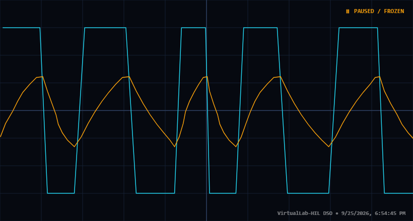
*Figure 5.1: Dual-trace oscilloscope capture showing square wave input and exponential RC integration.*

- **Channels**: Channel 1 (Cyan) and Channel 2 (Orange).
- **Controls**: Time/Div timebase, Volts/Div attenuators, Position Y offset, AC/DC coupling, and Invert.
- **Trigger**: Modes (Auto, Normal, Single), Source (CH1/CH2), Edge Slope (Rising/Falling), and Trigger Level.
- **Telemetry**: Automated readouts for $V_{pp}, V_{max}, V_{min}, V_{rms}$, Frequency, and Period.

### 5.2 Multi-Channel Digital Logic Analyzer
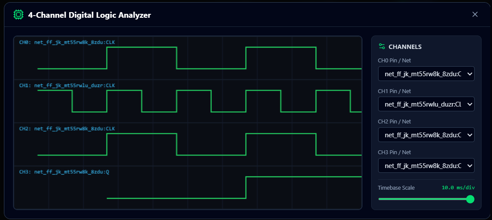
*Figure 5.2: 4-Channel digital timing diagram displaying clock and flip-flop transitions.*

- **Channels**: Up to 8 channels (D0–D7).
- **Features**: Digital timing diagrams, state/edge triggers, bus decoding (hex/decimal), and timing cursor $\Delta t$.

### 5.3 Characteristic Curve Analyzer (X-Y Sweeper)
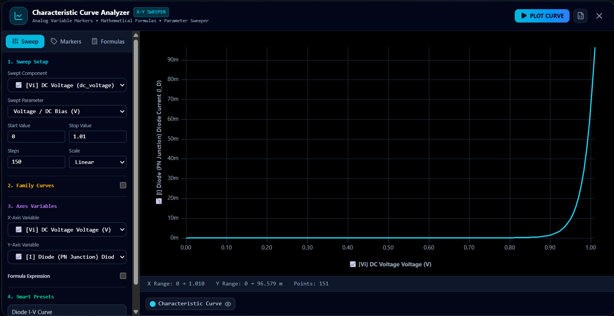
*Figure 5.3: Two-panel curve analyzer plotting Diode I-V curve with uPlot graphics.*

- **Left Panel**: Primary swept component/variable, secondary family stepping, start/stop values, step count, and smart circuit presets.
- **Right Panel**: High-resolution uPlot canvas, statistics bar, and interactive series legend with SI unit formatting (pA, nA, µA, mA, A, mV, V).

### 5.4 Combinational Truth Table Analyzer
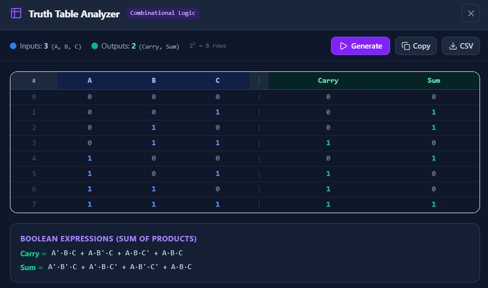
*Figure 5.4: Truth Table Analyzer displaying full adder truth table and Boolean SOP expressions.*

- Automatically detects all digital inputs and output probes on the canvas.
- Excites circuit through all $2^N$ binary combinations and renders boolean truth tables with Sum of Products (SOP) equations.

### 5.5 Arbitrary Function Generator
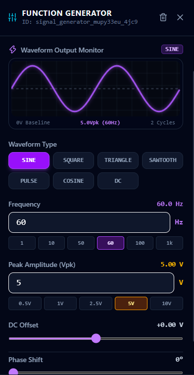
*Figure 5.5: Function generator controls showing 10 Hz sine wave, peak amplitude, and DC offset.*

- Synthesizes Sine, Square, Triangle, Sawtooth, Pulse, and DC waveforms.
- Direct output monitor preview, 10Hz default, and peak-to-peak amplitude dials.

---

## 6. Interactive Laboratory Presets & Step-by-Step Tutorials

VirtualLab-HIL includes **23 pre-wired, verified lab experiments** accessible via the **`🧪 Lab Presets & Tutorials`** button on the Component Palette.

---

### 6.1 RC Filters & Pulse Shapers

#### Lab 1: RC Low-Pass Filter (`rc_low_pass_filter`)
- **Objective**: Verify the 3dB cutoff frequency $f_c$ and observe high-frequency attenuation with phase lag.
- **Theory & Governing Formula**:
  $$f_c = \frac{1}{2\pi R C} = \frac{1}{2\pi (1\text{k}\Omega)(1\mu\text{F})} \approx 159.15\text{ Hz}$$
- **Procedure**:
  1. Open *Lab Presets & Tutorials* and click **Load Experiment** on *RC Low-Pass Filter*.
  2. Click **Run** and launch the **Oscilloscope**.
  3. At 10 Hz (well below $f_c$), observe $V_{out} \approx 4.99\text{ Vpk}$ (minimal loss) with $\approx -3.6^\circ$ phase lag.
  4. Select the AC source, increase frequency to 159 Hz, and verify $V_{out}$ drops to $3.53\text{ Vpk}$ ($70.7\%$).

#### Lab 2: RC High-Pass Filter (`rc_high_pass_filter`)
- **Objective**: Observe low-frequency DC blocking and phase lead.
- **Formula**:
  $$\phi = 90^\circ - \arctan(\omega R C)$$
- **Procedure**:
  1. Load *RC High-Pass Filter*. Launch Oscilloscope.
  2. At 10 Hz, observe heavy attenuation ($V_{out} \approx 0.31\text{ Vpk}$) with $+86.4^\circ$ phase lead.
  3. Increase frequency to 1 kHz; observe $V_{out}$ rising to $4.93\text{ Vpk}$ with zero phase shift.

#### Lab 3: RC Integrator & Pulse Shaper (`rc_integrator_step`)
- **Objective**: Study pulse shaping and triangular integration of square waves.
- **Formula**:
  $$\tau = R \cdot C = 10\text{k}\Omega \times 0.1\mu\text{F} = 1.0\text{ ms}$$
- **Procedure**:
  1. Load *RC Integrator & Pulse Shaper*. Run simulation.
  2. Observe CH1 (input 5V square wave) and CH2 (integrated exponential charging ramps).

---

### 6.2 Diodes, Limiters & Power Supplies

#### Lab 4: Diode Symmetrical Clipper (`diode_clipper`)
- **Objective**: Limit voltage excursions beyond diode forward drop ($\pm 0.7\text{V}$).
- **Formula**:
  $$V_{out, max} \approx +0.7\text{ V}, \quad V_{out, min} \approx -0.7\text{ V}$$
- **Procedure**:
  1. Load *Diode Symmetrical Clipper*. Run simulation.
  2. On the Oscilloscope, observe the 10Vpp input clipped symmetrically into a flat-topped waveform bounded between $\pm 0.7\text{V}$.

#### Lab 5: Diode Clamper / DC Restorer (`diode_clamper`)
- **Objective**: Add a DC offset to an AC signal without changing waveform shape.
- **Procedure**:
  1. Load *Diode Clamper*. Run simulation.
  2. On the scope, note that peak-to-peak amplitude remains 10Vpp, but the wave is shifted downward so the positive peak touches $+0.7\text{V}$.

#### Lab 6: Zener Diode 5.1V Voltage Regulator (`zener_voltage_regulator`)
- **Objective**: Maintain constant load voltage despite supply fluctuations.
- **Formula**:
  $$I_s = \frac{V_{in} - V_z}{R_s}, \quad I_L = \frac{V_z}{R_L}$$
- **Procedure**:
  1. Load *Zener 5.1V Regulator*.
  2. Observe the load voltmeter reading steady $5.10\text{V}$.
  3. Increase $V_{in}$ in the Inspector from 12V to 18V; confirm load voltage remains locked at 5.10V.

#### Labs 7 & 8: Full-Wave Bridge Rectifiers (Unfiltered & Filtered)
- **Objective**: Compare raw 120Hz pulsating DC with capacitor-smoothed DC.
- **Formula**:
  $$V_{ripple} \approx \frac{I_{load}}{2 f C}$$
- **Procedure**:
  1. Load *Full Wave Bridge Rectifier (Unfiltered)*; note pulsating 120Hz DC arches.
  2. Load *Full Wave Rectifier with Capacitor Filter*; note smooth DC output with $<150\text{mV}$ ripple.

---

### 6.3 BJT Transistor Amplifiers & Biasing

#### Lab 9: BJT DC Bias & Q-Point (`bjt_dc_bias`)
- **Objective**: Determine quiescent operating point ($I_B, I_C, V_{CE}$).
- **Formula**:
  $$I_C = \beta \cdot I_B, \quad V_{CE} = V_{CC} - I_C R_C$$

#### Lab 10: BJT Voltage Divider Bias (Stabilized) (`bjt_voltage_divider_bias`)
- **Objective**: Demonstrate beta-independent biasing using negative emitter feedback.
- **Procedure**:
  1. Load *BJT Voltage Divider Bias*.
  2. Measure $V_C \approx 7.4\text{V}, V_E \approx 2.1\text{V}, V_{CE} \approx 5.3\text{V}$.
  3. In Inspector, change transistor $\beta$ from 100 to 300; observe that $V_{CE}$ changes by less than 5%.

#### Lab 11: BJT Common-Emitter AC Amplifier (`bjt_small_signal_amp`)
- **Objective**: Achieve high AC voltage gain with 180° phase inversion.
- **Formula**:
  $$A_v = -\frac{R_C \parallel R_L}{r_e}$$

#### Lab 12: BJT Emitter Follower Buffer (`bjt_emitter_follower`)
- **Objective**: Unity voltage gain ($A_v \approx 1$), high input impedance, low output impedance.

---

### 6.4 MOSFETs & CMOS Digital Logic

#### Lab 13: NMOS Common-Source Amplifier (`mosfet_common_source`)
- **Objective**: Observe transconductance voltage amplification using square-law enhancement MOSFETs.
- **Formula**:
  $$I_D = \frac{K_n}{2}(V_{GS} - V_{th})^2, \quad A_v = -g_m R_D$$

#### Lab 14: CMOS Inverter (`cmos_inverter`)
- **Objective**: Study complementary PMOS/NMOS rail-to-rail digital switching.
- **Procedure**:
  1. Load *CMOS Inverter*. Run simulation.
  2. Click the Logic Input switch; observe output flipping cleanly between 5.00V and 0.00V.

---

### 6.5 Operational Amplifiers & Active Filters

#### Lab 15: Op-Amp Inverting Amplifier (`opamp_inverting_amp`)
- **Objective**: Verify virtual ground and closed-loop gain $A_v = -R_f/R_{in} = -5$.
- **Formula**:
  $$V_{out} = -\frac{R_f}{R_{in}} \cdot V_{in} = -5 \cdot V_{in}$$
- **Procedure**:
  1. Load *Op-Amp Inverting Amplifier*.
  2. Verify that input node IN- stays clamped at $0.00\text{V}$ (virtual ground).
  3. Scope CH2 displays a 5.0Vpk inverted sine wave for a 1.0Vpk input.

#### Lab 16: Op-Amp Non-Inverting Amplifier (`opamp_non_inverting_amp`)
- **Objective**: In-phase amplification with infinite input impedance.
- **Formula**:
  $$A_v = 1 + \frac{R_f}{R_1} = 1 + \frac{20\text{k}\Omega}{10\text{k}\Omega} = +3.0$$

#### Lab 17: Op-Amp Active Low-Pass Filter (`opamp_active_low_pass`)
- **Objective**: First-order active filter with passband gain and $-20\text{dB/decade}$ roll-off without loading sag.

#### Lab 18: Op-Amp Astable Relaxation Oscillator (`opamp_relaxation_oscillator`)
- **Objective**: Autonomous square wave generation using Schmitt-trigger hysteresis.
- **Formula**:
  $$T = 2 R C \ln\left(\frac{1 + \beta}{1 - \beta}\right) \approx 22\text{ ms} \implies f_{osc} \approx 45.5\text{ Hz}$$
- **Procedure**:
  1. Load *Op-Amp Relaxation Oscillator*.
  2. Launch Scope; observe CH1 displaying continuous 30Vpp square pulses ($\pm 15\text{V}$) and CH2 displaying triangular RC charge ramps ($\pm 7.5\text{V}$) without any external signal generator!

---

### 6.6 Digital Combinational MSI Circuits

#### Lab 19: 3-Input Binary Full Adder (`full_adder`)
- **Objective**: Binary arithmetic addition yielding Sum and Carry-out.
- **Formulas**:
  $$\text{Sum} = A \oplus B \oplus C_{in}, \quad C_{out} = (A \cdot B) + (C_{in} \cdot (A \oplus B))$$

#### Lab 20: 4-to-1 Multiplexer Data Selector (`mux_4to1_selector`)
- **Objective**: Route 1 of 4 data inputs to output Y using 2-bit select lines $S_0, S_1$.

#### Lab 21: BCD to 7-Segment Decoder (`decoder_bcd_7seg_display`)
- **Objective**: Drive individual LED segment lines ($a$ through $g$) from 4-bit BCD digits 0–9.

---

### 6.7 Digital Sequential Counters & Dividers

#### Lab 22: 4-Bit Binary Ripple Counter (`counter_4bit_clock`)
- **Objective**: Observe synchronous binary counting sequence $0000_2$ through $1111_2$ driven by a 5Hz clock.
- **Procedure**:
  1. Load *4-Bit Binary Counter*.
  2. Launch the **Logic Analyzer**; observe binary division across $Q_0, Q_1, Q_2, Q_3$.

#### Lab 23: D Flip-Flop Frequency Divider (`d_flip_flop_divider`)
- **Objective**: Divide clock frequency by exactly 2 ($f_{out} = f_{clk}/2$) by feeding $\bar{Q}$ back into $D$.

---

## 7. Custom Component (Black Box IC) Builder

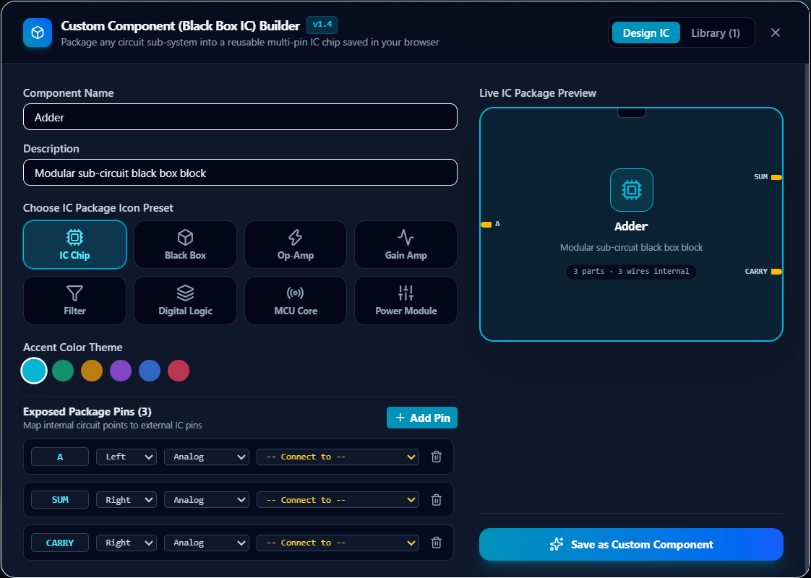
*Figure 7.1: Black Box IC packaging interface with pin assignment and live package preview.*

1. Assemble any circuit on the canvas.
2. Click **`Custom IC`** in the Navbar.
3. Choose an IC package geometry (DIP chip, Op-Amp, Digital Logic, Power Module) and accent color.
4. Define external pins (Left, Right, Top, Bottom) and map them to internal component terminals.
5. Click **Save as Custom Component**; your new IC chip appears at the top of the palette.
6. The engine recursively flattens custom IC sub-circuits into internal MNA equations, guaranteeing 100% exact simulation fidelity.

---

## 8. Gemini AI Natural Language Circuit Assistant

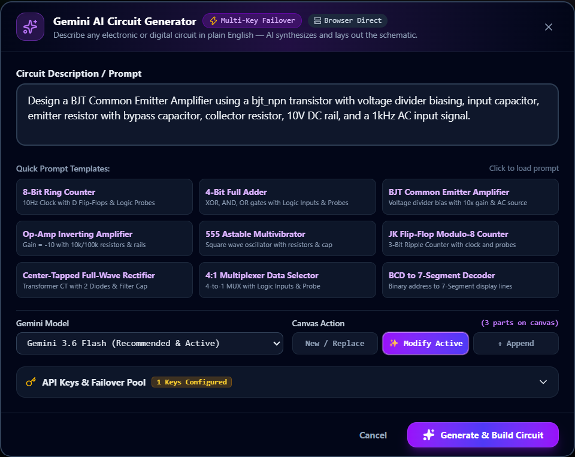
*Figure 8.1: Natural language circuit synthesis modal with quick templates and model selection.*

1. Click **`AI Circuit`** in the Navbar.
2. Select a quick prompt template or type your circuit description in plain English.
3. Choose your canvas mode:
   - **New / Replace**: Clears canvas and populates the synthesized circuit.
   - **Modify Active**: Updates existing components.
   - **Append**: Places the new circuit adjacent to existing parts.
4. Click **Generate & Build Circuit**; the AI compiler resolves pin aliases and auto-routes all connecting wires onto the grid.

---

## 9. Hardware-in-the-Loop (ESP32) Bridge

Connect physical hardware to VirtualLab-HIL over WebSockets:
1. Click **`HIL`** in the Navbar to open the HIL Bridge Console.
2. In the **Monitor** tab, confirm WebSocket connection status to `wss://virtuallabs-hil.onrender.com/ws/ui`.
3. Add `hil_ingress` components to schematic to read physical ESP32 ADC/GPIO pins.
4. Add `hil_egress` components to schematic to drive virtual voltages to physical ESP32 DAC/PWM pins.
5. In the **Simulator** tab, test signals using the built-in software generator without physical hardware connected.

---

## 10. Electrical Rules Checking (ERC) & Diagnostic Engine

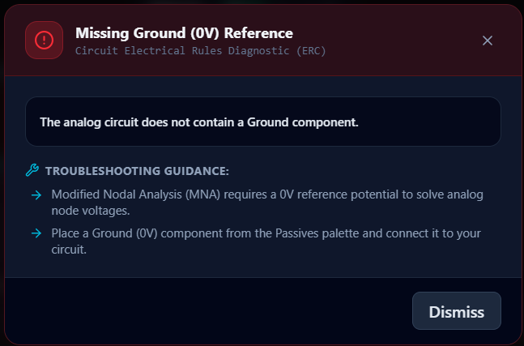
*Figure 10.1: ERC diagnostic alert pinpointing schematic connection errors.*

| Diagnostic Error | Root Cause | Solution |
|---|---|---|
| **Missing Ground (0V)** | Analog MNA solver requires a reference node to solve equations. | Drag a **Ground** component from Passives and wire to circuit. |
| **Floating Op-Amp Rail** | Op-Amp is set to external supply mode with $V+$ or $V-$ unconnected. | Connect DC supplies to $V+/V-$ or click **"Set Internal Rails (±15V)"** in Inspector. |
| **Voltage Source Loop** | Ideal voltage sources connected in parallel violate KVL. | Insert a small series resistor ($1\Omega$) in the branch. |

---

## 11. Desktop Keyboard Shortcuts & Canvas Gestures

| Keybinding / Gesture | Scope | Action Description |
|---|---|---|
| <kbd>Ctrl + Z</kbd> | Global Canvas | Undo last wire, component move, param change, or deletion. |
| <kbd>Ctrl + Y</kbd> / <kbd>Ctrl + Shift + Z</kbd> | Global Canvas | Redo previously undone action. |
| <kbd>Delete</kbd> / <kbd>Backspace</kbd> | Selection | Delete currently selected component or wire. |
| <kbd>R</kbd> | Component Node | Rotate selected component by 90° clockwise. |
| <kbd>Esc</kbd> | Modals | Close any active modal dialog. |
| **Scroll Wheel** | Canvas | Smooth zoom in / zoom out centered on cursor. |
| **Left Click + Drag** | Canvas Background | Pan schematic workspace. |
| **Terminal Drag** | Component Pins | Draw an active connection wire between pins. |

---

## 12. Troubleshooting & Frequently Asked Questions

**Q: Why do my wires turn orange?**  
A: Vibrant orange wires indicate that the simulation is running and current is actively flowing through the branch. Dashed particles illustrate the conventional direction of positive current.

**Q: Why does the probe show 'Z'?**  
A: The probe is either disconnected or connected to a high-impedance net with no driving signal. Ensure your signal path connects to a source or digital gate output.

**Q: Can I run circuits offline without internet?**  
A: Yes! VirtualLab-HIL runs entirely inside client browser JavaScript via WebAssembly/MNA. All simulation calculations, instruments, and custom IC storage work 100% offline. Internet access is only required for Gemini AI synthesis and live ESP32 cloud bridge streaming.
